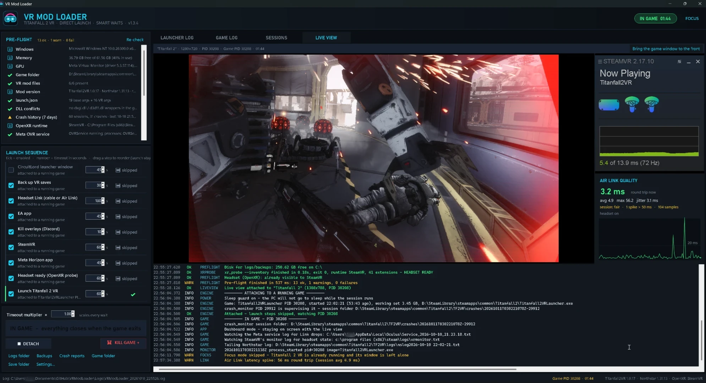

# VR Mod Loader

One-click launcher and session dashboard for **Titanfall 2 VR** (CircuitLord's mod). It brings the VR stack up in
the right order, waits for each piece to actually be ready instead of sleeping, launches the mod directly, watches
the game and the headset link, and tears everything down when you're done.



```
pre-flight → back up saves → kill Discord → Meta Horizon → SteamVR → EA app
          → (CircuitLord window, optional) → headset probe → direct launch → in game (dashboard + live view)
          → crash / link-drop analysis → 15 s countdown → close SteamVR / EA / Meta / CircuitLord → restart Discord
          → desktop restored
```

## Build

Nothing to install - it uses the C# compiler that ships with Windows (.NET Framework 4.8).

```bash
powershell -ExecutionPolicy Bypass -File .\build.ps1 -Run
```

That produces `VRModLoader.exe` next to this file plus a desktop shortcut. `-RebuildIcon` redraws `assets\app.ico`,
`-Bump patch|minor|major` increments the `VERSION` file before building. Start the exe with `--windowed` to skip
focus mode for one run.

Or skip the build: grab the exe from the [latest release](https://github.com/Oldandcranky/VRModLoader/releases),
drop it in a folder of its own and run it. On first run it detects the game folder (CircuitLord's installer settings,
registry, Steam libraries, default EA folders, drive scan), the Meta Horizon client, the EA app and CircuitLord's exe,
writes them to `settings.json`, and everything is editable in Settings.

## Layout

| Path | What |
|---|---|
| `VRModLoader.exe` | the app (built) |
| `settings.json` | every option, hand-editable; written on first run |
| `Logs\VRModLoader_<stamp>.log` | full launcher log per run (same lines as the in-app log, with DEBUG) |
| `Logs\VRModLoader_<stamp>_game.log` | mirror of Northstar's `nslog`, `crash_monitor`, Meta service and SteamVR monitor lines |
| `Backups\TF2VR_<stamp>\` | copies of `%LOCALAPPDATA%\Respawn\Titanfall2_VR` (videos skipped), last 10 kept |
| `Sessions\history.json` | one record per session: outcome, play time, exit code, crash / link-drop reason, step timings |
| `src\` | C# sources (C# 5 / .NET 4.8, WinForms) |
| `tools\make-icon.ps1` | draws the icon in code |

## Smart waits

Each step has a readiness signal, a timeout (editable in its row) and a global multiplier. Drag a step row to
reorder the sequence (the launch step stays last); the order is saved in `settings.json`.

| Step | Ready when |
|---|---|
| Kill overlays | none of the kill-list processes remain |
| Meta Horizon | `OVRServer_x64` **and** the Meta client (`Client.exe` under `Meta Horizon\Support\oculus-client`; `OculusClient.exe` is only a 0-byte alias) |
| Headset Link | the Quest is streaming - cable: USB `VID_2833&PID_5010` (it re-enumerates from `PID_5011` when Link starts); Air Link or cable: `OculusDash.exe` running. Link can only be started from the headset (Quick Settings → Link → your PC); while waiting, a banner tells the person holding the headset exactly that. |
| SteamVR | `vrserver`, `vrmonitor` **and** `vrcompositor` (the compositor only appears once SteamVR sees the headset) |
| EA app | `EADesktop` |
| Headset probe | the mod's own `TF2VR\tools\xr_probe.exe --inventory` reports no `XR_ERROR_*` - OpenXR can see the headset. Retries every 3 s. |
| Launch | `Titanfall2VRLauncher.exe` appears |

On a timeout: **Keep waiting / Continue anyway / Stop**. If the game is already running when you press LAUNCH you
get **Attach & watch** (skip every step, just watch that session) or **Full sequence**.

## Direct launch

Replicates CircuitLord's *Launch in VR* button exactly: reads `TF2VR\tools\launch.json`, fills the placeholders,
scrubs `TF2VR_*`, `VR_PATHREG_OVERRIDE`, `VR_CONFIG_PATH`, `VR_LOG_PATH`, `XR_RUNTIME_JSON` from the environment,
sets `TF2VR_OPENXR=1`, and runs `TF2VR\tools\crash_monitor.exe "<game>\TF2VR" "<game>\Titanfall2VRLauncher.exe" <args>`
from the game folder (verified byte-for-byte against a live CircuitLord launch). If that fails it falls back to
opening CircuitLord's window.

## In game

- **Dashboard**: the launcher stays on screen; the **LIVE VIEW** tab shows the game's mirror window live (a DWM
  thumbnail - zero load, no input), the SteamVR Status window (device icons, frame graph) beside it, a **link quality**
  panel (round trip now / avg / max / jitter, spikes, sparkline, headset battery - from Meta's per-second clock-sync
  samples, Air Link or cable) and a compact log underneath.
- **SteamVR frame stats**: the launcher reads SteamVR's compositor numbers as a background OpenVR observer (it never
  becomes the scene app): GPU render time against the refresh budget, dropped frames and reprojected frames, live on
  the dashboard and saved per session.
- **Headset link watch**: Meta's service log and SteamVR's monitor log are tailed. USB errors, `termination_reason`,
  SteamVR Standby and low headset battery show up red, pop a tray balloon, and go into the session record.
- **OLED guard**: after 2 min without mouse/keyboard the screen goes near-black with a dim, drifting timer and a
  small drifting live view. Any input brings the dashboard back.
- **Sleep guard**: the PC is held awake while a session runs (never the display).
- **☠ KILL GAME + CLOSE ALL** does exactly that - it is the emergency stop, not the way to end a session. Quit the
  game from inside VR and the launcher tears everything down by itself after a cancellable countdown.

## Stats and updates

- **STATS tab**: totals over your whole history - sessions, play time, crash rate, link quality split by Air Link vs
  USB Link, SteamVR frame stats, and a bar chart of recent session lengths.
- **Self-update**: on start the launcher checks the latest GitHub release. When a newer one exists an
  **UPDATE TO x.y.z** button appears in the header; one click downloads, verifies and installs it and restarts,
  keeping your settings, logs, backups and history.
- **LAUNCH / ATTACH**: the big button reads ATTACH TO RUNNING GAME whenever Titanfall 2 VR is already up, and glows
  while it is the thing to press.

## Focus mode

On start: every other window is minimized (Windows' own Win+D) and the launcher goes borderless fullscreen with
window buttons in its header (F11 toggles). Launched apps' windows are minimized as they become ready. After the
tear-down the launcher drops back to a normal window and your windows come back. Skipped automatically when a game
is already running.

## Crash and drop analysis

After the game exits the launcher reads the `crash_monitor` session folder (`TF2VR\crashes\<utc>-<pid>`): `incident.txt`,
`stderr.txt`, the exit code in `monitor.txt` and the `exception-*` capture. A crash (or an exit shorter than the crash
threshold) skips the auto-close, shows the reason, and offers **RELAUNCH**. Known causes seen on this machine:

- `OpenXR couldn't start … XR_ERROR_FORM_FACTOR_UNAVAILABLE` → the game started before the headset was ready (the
  headset-probe step prevents this).
- `WinUsb_WritePipe failed (31)` + `termination_reason: device_error` in Meta's log → the USB Link connection faulted
  mid-session; the game then runs headless. Check the cable / use a USB 3 port on the motherboard.
